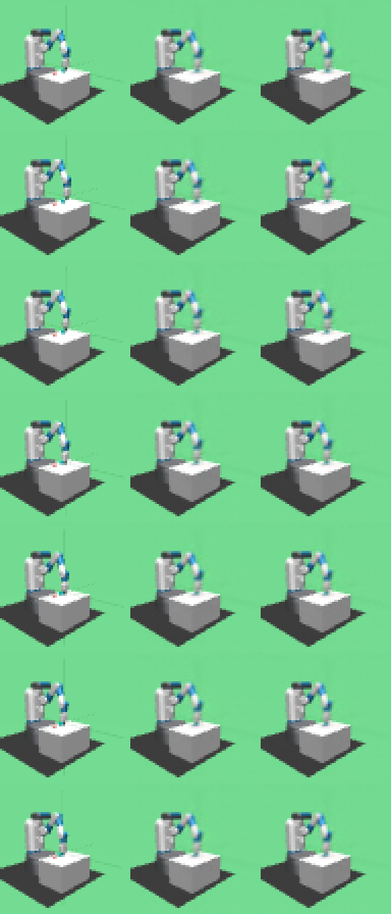
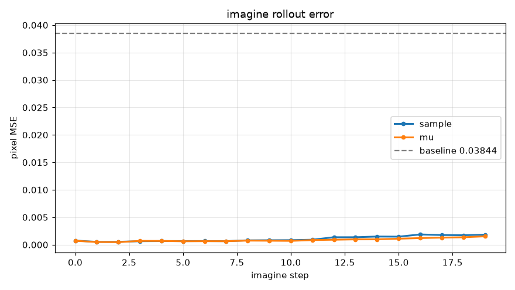
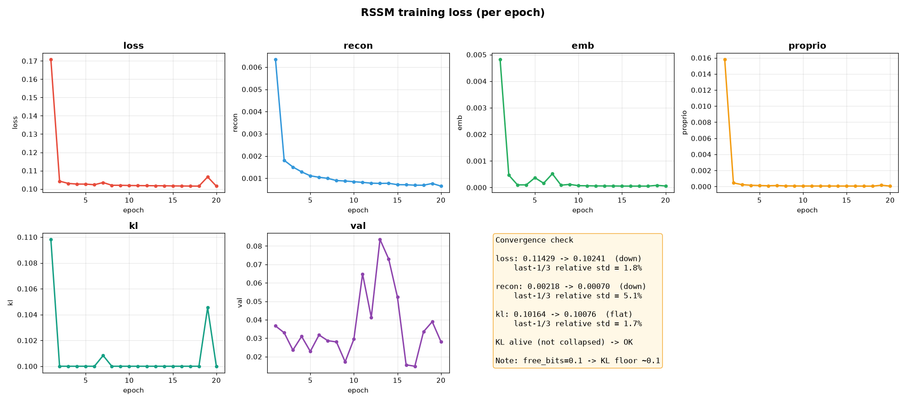
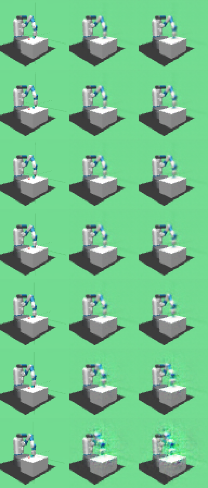

# PRISM-WM 结果展示

基于 **RSSM**（循环状态空间模型）的机器人操作世界模型，任务环境为 MuJoCo `FetchPush-v4`（推动桌面方块）。

**当前状态**：v5（加入物体位置预测头后）的闭眼推演**首次优于"假设世界静止不动"**。

---

## 1. 当前最佳结果：v5（物体位置预测头）

### 核心指标（20 步想象，验证集样本 #57）

| 指标 | v2（无位置头） | **v5（有位置头）** | 变化 |
|---|---|---|---|
| 末端位置误差 | 21.01 cm | **6.78 cm** | ✅ 降 67% |
| **vs 静止基线** | 2.60×（差于静止）❌ | **0.73×（优于静止）** | ✅ **首次为正** |
| 物体位置误差 | 无法评测 | **7.73 cm** | ✅ 首次可测 |
| 物体 vs 静止基线 | — | 0.68×（静止 11.43cm） | ✅ 优于静止 |
| 物体位移方向 (dy) | — | 预测 −0.072 / 真实 −0.068 | ✅ 方向一致 |
| 像素 MSE | 0.00252 | **0.00183** | ✅ 降 27% |
| 真实 KL | 0.020 | 0.026 | +30% |

> **静止基线** = 假设世界完全不动时的误差。若模型误差 > 静止基线，说明"想象不如什么都不做"。

### 效果图：真实 vs 想象（三列对比）



*7 行 × 3 列：**左=真实帧｜中=sample 想象｜右=mu 想象**，从上到下为 step 0 / 3 / 6 / 9 / 12 / 15 / 18。*
*模型全程不看任何真实图像，只用 prior 递归推演。*

### 想象误差曲线



*每步像素 MSE（sample / mu 两条），20 步仅 0.0018，远低于基线 0.0384。*

### 训练曲线（含新增的 object 项）



*`object` 项（物体位置预测 loss）从 0.0345 降到 0.0008，降 **38 倍**。*

---

## 2. 对比：v2（未加位置头）



v2 的画面重建同样清晰，但**末端位置误差 21cm，差于静止基线 8cm（2.6×）**——
即"能画出世界长什么样，但预测不了世界会怎么变"。

v5 的关键改动只有约 60 行：

```python
self.object_pred = nn.Linear(hidden_dim + latent_dim, 3)   # (h,z)232 -> 3
object_mse = MSE(out['object_pred'], object_pos)
total += object_weight * object_mse
```

---

## 3. 泛化测试（新数据集，不重训）

采集两份新数据（各 120 局），**直接用 v5 模型测试**：

| 数据集 | 说明 | 末端误差 | vs 静止基线 |
|---|---|---|---|
| 原 L0 | 训练时用的数据 | 8.76 cm（样本#0） | 1.02× |
| **L0_new** | 同分布、**新随机种子**（未见过） | **4.60 cm** | **0.43×** ✅ |
| **L0_color** | **方块改红色**（OOD） | **2.60 cm** | **0.17×** ✅ |

**结论**：机械臂动力学**泛化良好**——在未见过的新数据、以及方块颜色改变时，末端预测仍优于静止假设（且比训练数据上更好），说明模型**不是背数据**。

### ⚠️ 已知局限（诚实说明）

1. **单样本评测噪声大**：每个数据集只测了 1 条序列（样本 #0）。不同样本间差异可达 20 倍（#57 上物体误差 7cm，#0 上 180cm），因此上述数字**只能作为初步观察**，需多样本平均才能定论。
2. **物体预测在样本 #0 上失效**：原 L0 在新样本 #0 上物体误差也高达 ~180cm，说明这是**该样本本身难**（episode 开局、物体未被接触），而非泛化差。
3. **背景颜色无法修改**：地面（`floor0`）颜色由材质/渲染器缓存控制，改 `geom_rgba`、`mat_rgba` 均无效（已在采集脚本参数中标注）。方块颜色可改（`--obj-color`）。

---

## 4. 笔记（图解，本地打开）

HTML 笔记在 `prism/docs/` 下（GitHub 不渲染 HTML，请 clone 后本地打开）：

| 笔记 | 内容 |
|---|---|
| `01_一帧图的旅程_Encoder.md` | Encoder 与形状变化 |
| `03_卷积与通道.html` | 卷积、kernel、通道数（含交互演示） |
| `04_RSSM_记忆与潜变量.html` | h / z、prior / posterior、时间对齐 |
| `05_训练时优化什么_loss四项.html` | 四项 loss、KL 公式、free_bits |
| `06_训练流程与数据流转.html` | 数据切分、主循环、proprio/action 字段 |
| `08_PyTorch张量语法速查.html` | 切片 / squeeze / permute / contiguous（5 张图） |
| `10_训练迭代报告_v1到v2.html` | v1 训飞 → v2 修复 → **v5 突破** |
| `11_KL为什么不能太大或小.html` | KL 适中性、贯穿 observe→imagine |
| `12_v5物体位置预测头.html` | v5 背景、逐行代码、新流程图 |
| `13_高斯分布与采样怎么理解.html` | 高斯、logvar、采样、重参数化、VAE（3 张图） |

---

## 5. 复现步骤

```bat
:: 训练（改 prism/config.yaml 里的参数，然后双击）
prism\tools\run_train.bat

:: 推理 / 想象（自动用最新权重，结果按时间戳归档）
prism\tools\run_imagine.bat

:: 分析位置误差 vs 静止基线
python prism/tools/analyze_imagine_error.py prism/runs/imagine_<时间戳>
```

参数集中在 `prism/config.yaml`（训练 + 推理），无需命令行传参。
每次运行会在 `prism/runs/` 下生成带时间戳的目录（权重、loss 曲线、对比图、每步数据 CSV）。

---

## 6. 已知问题与下一步

| 问题 | 状态 |
|---|---|
| 想象误差 6.78cm（优于静止但偏大） | 待优化：加大 `object_weight`、数据侧增大物体运动幅度 |
| 物体位置预测在部分样本失效 | 根因可能是"方块仅 1~2 像素"，视觉信号太弱 |
| 背景颜色无法修改（OOD 受限） | 技术限制，需后期处理或换场景 |
| MPC 决策 | 已跑通链路，代价函数待改用**预测的物体位置** |

**下一步优先级**：① 多样本泛化评测 ② MPC 用物体位置做代价 ③ 加大物体运动幅度重采数据。
